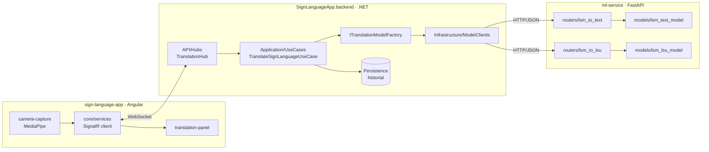

# Proyecto Señas 🤟

Aplicación para **traducir lengua de señas en tiempo real** a partir de la cámara del usuario.

- **LSM → Texto**: reconoce señas de Lengua de Señas Mexicana y las muestra como texto en español (y opcionalmente voz).
- **LSM → LSU**: traduce de Lengua de Señas Mexicana a Lengua de Señas Uruguaya.

> Estado: **fase de diseño**. La estructura de carpetas está definida; aún no hay código.

---

## 1. Arquitectura general

El proyecto se divide en **tres servicios independientes**, cada uno con una sola responsabilidad:

| Servicio | Tecnología | Responsabilidad |
|---|---|---|
| `sign-language-app` | Angular | Capturar la cámara, extraer puntos clave (landmarks), mostrar la traducción e historial |
| `SignLanguageApp.backend` | .NET (Clean Architecture) | Orquestar: autenticación, reglas de negocio, elegir el modelo correcto, guardar historial, tiempo real (SignalR) |
| `ml-service` | Python + FastAPI | **Solo inferencia**: recibe landmarks, devuelve la predicción del modelo |



### Flujo de una traducción

1. El usuario elige el par de idiomas en `language-selector` (ej. LSM → Texto).
2. `camera-capture` abre la cámara y usa **MediaPipe Holistic en el navegador** para extraer landmarks de manos y cuerpo por cada frame.
3. Se agrupa una ventana de frames (ej. 30 frames ≈ 1 segundo) y se envía al `TranslationHub` por SignalR.
4. El backend valida la petición, y `ITranslationModelFactory` elige el cliente de modelo según el `LanguagePair`.
5. El `ModelClient` llama por HTTP al endpoint correspondiente de `ml-service`.
6. `ml-service` normaliza los datos (`preprocessing`), ejecuta el modelo y devuelve la predicción + confianza.
7. El backend guarda el resultado en el historial y lo envía de vuelta al cliente por el hub.
8. `translation-panel` muestra el texto (y opcionalmente lo reproduce con voz).

> **¿Por qué enviar landmarks y no video?** Un frame de video pesa decenas de KB; los landmarks de un frame son ~75 puntos × 3 coordenadas. Es mucho más rápido, más barato y no se mandan imágenes del rostro del usuario al servidor (privacidad).

---

## 2. Estructura del repositorio

```
Proyecto_señas/
├── sign-language-app/          # Frontend Angular
├── SignLanguageApp.backend/    # Backend .NET
├── ml-service/                 # Servicio de modelos (Python)
└── README.md
```

---

## 3. Frontend — `sign-language-app` (Angular)

```
src/app/
├── core/                       # Se instancia una sola vez en toda la app
│   ├── guards/                 # auth.guard.ts → protege rutas que requieren login
│   ├── interceptors/           # auth.interceptor.ts (agrega JWT), error.interceptor.ts
│   └── services/
│       ├── auth.service.ts
│       ├── translation-hub.service.ts   # conexión SignalR
│       ├── translation-api.service.ts   # llamadas HTTP (historial, idiomas)
│       └── landmark-extractor.service.ts# wrapper de MediaPipe
├── features/                   # Una carpeta por pantalla/funcionalidad
│   ├── home/
│   ├── camera-capture/         # <video>, captura frames, extrae landmarks
│   ├── language-selector/      # elige origen/destino
│   ├── translation-panel/      # muestra resultado en vivo
│   └── history/                # traducciones anteriores
├── models/                     # Interfaces/tipos TypeScript
│   ├── sign-language.enum.ts
│   ├── language-pair.model.ts
│   ├── translation-request.model.ts
│   └── translation-response.model.ts
├── shared/                     # Reutilizable, sin lógica de negocio
│   ├── components/             # botones, loaders, cards
│   ├── directives/
│   └── pipes/                  # ej. confidence.pipe.ts (0.93 → "93%")
├── app.config.ts
├── app.routes.ts
└── app.ts
```

**Regla simple:** `core` = servicios únicos, `features` = pantallas, `shared` = piezas visuales reutilizables, `models` = tipos.

---

## 4. Backend — `SignLanguageApp.backend` (.NET, Clean Architecture)

Las dependencias apuntan **siempre hacia adentro**:

```
API ──► Application ──► Domain
 │            ▲
 └──► Infrastructure (implementa las interfaces de Application)
```

`Domain` no conoce a nadie. `Application` define *qué* se necesita (interfaces). `Infrastructure` define *cómo* (HTTP, base de datos). `API` expone todo hacia afuera y conecta las piezas con inyección de dependencias en `Program.cs`.

### 4.1 `SignLanguageApp.Domain` — el núcleo
```
Entities/
  User.cs
  TranslationSession.cs     # una sesión de cámara (inicio, fin, par de idiomas, usuario)
  TranslationRequest.cs     # una petición dentro de la sesión
  TranslationResult.cs      # texto/glosas resultantes + confianza
Enums/
  SignLanguage.cs           # LSM, LSU
  InputType.cs              # Landmarks, Image, Video
ValueObjects/
  LanguagePair.cs           # (Source, Target) — inmutable, valida pares permitidos
Exceptions/
  UnsupportedLanguagePairException.cs
```

```csharp
public enum Language { LSM, LSU, SpanishText }

public sealed record LanguagePair(Language Source, Language Target)
{
    public override string ToString() => $"{Source}->{Target}";
}
```

### 4.2 `SignLanguageApp.Application` — casos de uso
```
Interfaces/
  ITranslationModel.cs          # contrato de cualquier modelo de traducción
  ITranslationModelFactory.cs   # elige el modelo según el LanguagePair
  ITranslationRepository.cs     # guardar/consultar historial
DTOs/
  TranslationModelRequest.cs    # lo que se le manda a un modelo
  TranslationModelResult.cs     # lo que devuelve un modelo
UseCases/
  TranslateSignLanguageUseCase.cs
  GetAvailableLanguagesUseCase.cs
  GetTranslationHistoryUseCase.cs
Validators/                     # FluentValidation
Mappings/
  TranslationProfile.cs         # AutoMapper (Entity ↔ DTO)
```

```csharp
public interface ITranslationModel
{
    LanguagePair SupportedPair { get; }
    Task<TranslationModelResult> TranslateAsync(TranslationModelRequest request, CancellationToken ct);
}

public interface ITranslationModelFactory
{
    // Lanza UnsupportedLanguagePairException si no hay modelo para el par
    ITranslationModel Resolve(LanguagePair pair);
}
```

**Por qué esta pieza es clave:** agregar un nuevo par (ej. LSM → ASL) será solo crear un nuevo cliente en Infrastructure y registrarlo; los casos de uso no cambian.

### 4.3 `SignLanguageApp.Infrastructure` — implementaciones
```
ModelClients/
  LsmToTextModelClient.cs       # implementa ITranslationModel → POST a ml-service
  LsmToLsuModelClient.cs
ModelRegistry/
  TranslationModelFactory.cs    # implementa ITranslationModelFactory
Persistence/
  AppDbContext.cs               # EF Core
  Configurations/
  Repositories/TranslationRepository.cs
SpeechServices/
  TextToSpeechService.cs        # opcional: texto → audio
```

La URL de `ml-service` va en `appsettings.json`:
```json
"MlService": { "BaseUrl": "http://localhost:8000" }
```

### 4.4 `SignLanguageApp.API` — entrada
```
Controllers/
  AuthController.cs             # login / registro → JWT
  LanguagesController.cs        # GET pares disponibles
  TranslationController.cs      # POST traducción puntual, GET historial
Hubs/
  TranslationHub.cs             # streaming en tiempo real (SignalR)
DTOs/                           # contratos públicos de la API (lo que ve el frontend)
Middlewares/
  ExceptionHandlingMiddleware.cs
  RequestLoggingMiddleware.cs
Program.cs                      # DI, CORS, JWT, SignalR, Swagger
```

> **DTOs de API vs DTOs de Application:** los de `API/DTOs` son el contrato con el frontend; los de `Application/DTOs` son el contrato interno con los modelos. Separarlos permite cambiar uno sin romper el otro.

### 4.5 `SignLanguageApp.Tests`
Pruebas unitarias de Domain y UseCases (xUnit + Moq), mockeando `ITranslationModelFactory` y `ITranslationRepository`.

---

## 5. Servicio de ML — `ml-service` (Python + FastAPI)

```
ml-service/
├── app/
│   ├── main.py                 # crea la app FastAPI e incluye routers
│   ├── routers/
│   │   ├── lsm_to_text.py      # POST /lsm-to-text/predict
│   │   └── lsm_to_lsu.py       # POST /lsm-to-lsu/predict
│   ├── models/
│   │   ├── lsm_text_model/     # carga pesos + método predict()
│   │   └── lsm_lsu_model/
│   ├── preprocessing/
│   │   └── landmarks.py        # normalizar, rellenar frames faltantes
│   └── schemas/                # Pydantic: request/response
│       ├── prediction_request.py
│       └── prediction_response.py
├── training/                   # (recomendado) notebooks y scripts de entrenamiento
├── weights/                    # (recomendado) .h5/.onnx/.pt — NO subir a git
├── tests/
└── requirements.txt
```

**Separar entrenamiento de servicio:** `app/` solo carga un modelo ya entrenado y responde. Todo lo de datasets y entrenamiento vive en `training/`.

---

## 6. Contratos entre servicios

### Front → Backend (SignalR, método `SendFrames`)
```json
{
  "sessionId": "b3f1...",
  "source": "LSM",
  "target": "SpanishText",
  "frames": [
    [[0.51, 0.32, -0.01], [0.49, 0.35, -0.02], "... 75 puntos por frame"],
    "... 30 frames"
  ]
}
```

### Backend → Front (SignalR, evento `TranslationReceived`)
```json
{
  "text": "hola",
  "glosses": ["HOLA"],
  "confidence": 0.93,
  "timestamp": "2026-10-22T14:03:00Z"
}
```

### Backend → ml-service (`POST /lsm-to-text/predict`)
```json
{ "frames": [[[0.51, 0.32, -0.01], "..."]] }
```
Respuesta:
```json
{ "label": "HOLA", "confidence": 0.93, "top_k": [["HOLA", 0.93], ["GRACIAS", 0.04]] }
```

**75 puntos por frame** = 33 de pose + 21 por cada mano (MediaPipe Holistic). Se puede agregar el rostro más adelante si el modelo lo necesita.

---

## 7. Nota sobre LSM → LSU

Traducir de una lengua de señas a otra no es directo, porque la salida también es una seña. Se propone hacerlo como **pipeline**:

```
Landmarks LSM ──► Reconocimiento ──► Glosas LSM ──► Traducción ──► Glosas LSU ──► Representación
                 (lsm_text_model)    ["HOLA"]      (diccionario /   ["HOLA"]     (video, GIF
                                                    modelo seq2seq)              o avatar)
```

Así `lsm_lsu_model` reutiliza el reconocedor de LSM, y la parte nueva es solo la traducción de glosas y cómo mostrarlas. Para un MVP basta un diccionario de glosas LSM→LSU con un video/GIF por seña.

---

## 8. Cómo correr el proyecto (cuando exista código)

```bash
# 1. ml-service
cd ml-service
python -m venv venv && source venv/bin/activate   # Windows: venv\Scripts\activate
pip install -r requirements.txt
uvicorn app.main:app --reload --port 8000

# 2. backend
cd SignLanguageApp.backend
dotnet run --project SignLanguageApp.API

# 3. frontend
cd sign-language-app
npm install
ng serve
```

| Servicio | URL |
|---|---|
| Frontend | http://localhost:4200 |
| Backend (Swagger) | https://localhost:5001/swagger |
| ml-service (docs) | http://localhost:8000/docs |

---

## 9. Hoja de ruta

- [ ] **Fase 1 — Esqueleto funcional:** los 3 servicios se comunican de punta a punta con un modelo *falso* que siempre devuelve "HOLA".
- [ ] **Fase 2 — Cámara real:** MediaPipe en Angular, envío de landmarks por SignalR.
- [ ] **Fase 3 — Primer modelo:** reconocer ~10 señas estáticas de LSM (alfabeto o palabras básicas).
- [ ] **Fase 4 — Persistencia y auth:** historial en base de datos, login con JWT.
- [ ] **Fase 5 — Señas dinámicas:** modelo secuencial (LSTM/GRU o Transformer) sobre ventanas de frames.
- [ ] **Fase 6 — LSM → LSU:** diccionario de glosas + representación visual.
- [ ] **Fase 7 — Extras:** texto a voz, Docker Compose, despliegue.

---

## 10. Pendientes de limpieza en la estructura actual

- Renombrar `READ.MD` → `README.md` (GitHub solo muestra automáticamente `README.md`).
- Eliminar los `Class1.cs` que genera la plantilla de .NET.
- `Infrastructure/MLModels/` se puede eliminar: los modelos viven en `ml-service`, y .NET solo los consume vía `ModelClients`.
- En el frontend, `models/` no necesita una carpeta por modelo; un archivo `.ts` por tipo es suficiente.
- Agregar `.gitignore` para `node_modules/`, `bin/`, `obj/`, `venv/`, `__pycache__/` y `weights/`.
