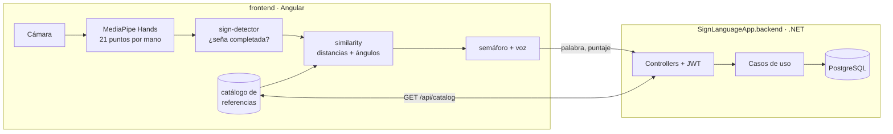

# SignLink 🤟

Aplicación web que traduce en tiempo real señas de la **Lengua de Señas Mexicana (LSM)** a texto y voz,
con un vocabulario acotado a **emergencias y atención médica**, para que el personal de salud entienda
a un paciente sordo cuando no hay intérprete.

- **Una cámara web estándar**, sin hardware especial.
- **Reconocimiento por reglas** con MediaPipe Hands: se comparan distancias y ángulos entre los 21 puntos
  de la mano contra referencias registradas. **No se entrena ningún modelo de IA.**
- **Semáforo de certeza** (verde / amarillo / rojo) para decidir cuándo confiar en la traducción.
- **Privacidad:** el video se procesa solo en el navegador; al servidor llegan únicamente las palabras.

Documentación de diseño en [`docs/`](docs/): modelo entidad-relación y diagrama de casos de uso.

---

## 1. Arquitectura

| Parte | Tecnología | Responsabilidad |
|---|---|---|
| `frontend/` | Angular 21 + MediaPipe Tasks Vision | Cámara, detección de manos, **comparación geométrica**, semáforo, voz, historial y exportación |
| `SignLanguageApp.backend/` | .NET 10 (Clean Architecture) + EF Core | Login con roles (JWT), catálogo de señas, consultas e historial, reglas de negocio |
| PostgreSQL 17 | `docker-compose.yml` | Persistencia (ver `docs/modelo-er.png`) |



### Flujo de una traducción
1. El médico inicia sesión y pulsa **Iniciar** (RNF-07: un clic desde la pantalla principal).
2. El navegador abre la cámara y MediaPipe Hands detecta los 21 puntos de cada mano, que se dibujan sobre el video.
3. Cuando la mano se mantiene quieta unos cuadros, la seña se da por **completada**.
4. Se calculan 12 distancias y 15 ángulos por mano, normalizados respecto a la muñeca (no importa la posición ni la distancia a la cámara).
5. Se comparan contra cada referencia del catálogo y gana la de mayor puntaje (0–100).
6. Se muestra la palabra al instante con su semáforo:
   - **verde** (≥ 80): entra a la frase y se lee en voz alta si está activado;
   - **amarillo** (60–79): el médico la confirma o descarta (10 s; si no, queda "no confirmada");
   - **rojo** (< 60): "Por favor repita la seña".
7. El navegador manda al backend solo la seña, el puntaje y la hora; el backend recalcula el nivel con sus umbrales y lo guarda en el historial.
8. Al finalizar, el resumen se descarga como `.txt` o se copia al portapapeles.

---

## 2. Estructura

```
sign-language-app/
├── frontend/                   # Angular (ver frontend/README.md)
├── SignLanguageApp.backend/    # Solución .NET
│   ├── SignLanguageApp.Domain/          # Entidades y reglas (semáforo, ciclo de la consulta)
│   ├── SignLanguageApp.Application/     # Un caso de uso por CU del documento
│   ├── SignLanguageApp.Infrastructure/  # EF Core, repositorios, JWT, hash de contraseñas
│   ├── SignLanguageApp.API/             # Controllers, middlewares, Program.cs
│   ├── SignLanguageApp.Tests/           # Pruebas unitarias
│   └── SignLanguageApp.IntegrationTests/# Pruebas con PostgreSQL real (Testcontainers, requiere Docker)
├── docs/                       # Modelo ER y casos de uso (+ script que los genera)
└── docker-compose.yml
```

---

## 3. Backend — endpoints

| Método | Ruta | Rol | CU |
|---|---|---|---|
| `POST` | `/api/auth/login` | — | CU-01 |
| `GET` | `/api/config/certainty` | — | umbrales del semáforo |
| `GET` | `/api/categories` · `/api/catalog?categoryId=` | — | CU-12 |
| `POST` | `/api/catalog/references` | Administrador | CU-13 |
| `POST` / `GET` | `/api/consultations` | Personal médico | CU-02 / CU-10 |
| `GET` | `/api/consultations/{id}` | Personal médico | CU-10 |
| `POST` | `/api/consultations/{id}/pause` · `resume` · `finish` | Personal médico | CU-03 / CU-04 |
| `POST` | `/api/consultations/{id}/records` | Personal médico | CU-05 / CU-06 |
| `POST` | `/api/consultations/{id}/records/{rid}/confirm` · `discard` · `not-confirmed` | Personal médico | CU-07 |
| `DELETE` | `/api/consultations/{id}/records` | Personal médico | CU-10 |
| `GET` | `/api/consultations/{id}/summary` | Personal médico | CU-11 (`.txt`) |

Configuración en `SignLanguageApp.API/appsettings.json`:
- `Certainty` — umbrales del semáforo (80 / 60) y segundos para confirmar (10). Es el "archivo de configuración" de RF-06.
- `Jwt` — emisor y vigencia. La **clave** solo está en `appsettings.Development.json`; en otro entorno se define con la variable `Jwt__Key` (mínimo 32 caracteres).
- `TimeZone` — zona horaria de las horas del resumen.

En desarrollo, al arrancar se aplican las migraciones y se crean las categorías y dos usuarios de prueba:

| Rol | Correo | Contraseña |
|---|---|---|
| Administrador | `admin@signlink.local` | `Admin123!` |
| Personal médico | `medico@signlink.local` | `Medico123!` |

---

## 4. Cómo correr el proyecto

Requisitos: .NET 10 SDK, Node 22.12+, Docker.

```bash
# 1. Base de datos (puerto 5462)
docker compose up -d

# 2. Backend → http://localhost:5090  (OpenAPI en /openapi/v1.json)
cd SignLanguageApp.backend
dotnet run --project SignLanguageApp.API

# 3. Frontend → http://localhost:4200
cd frontend
npm install
npm start
```

> Si tienes una base de datos de una versión anterior del proyecto (con las tablas `TranslationSessions`, etc.),
> bórrala antes con `docker compose down -v`: el esquema cambió por completo.

### Primeros pasos
1. Entra como **administrador** → *Registrar seña*: escribe la palabra, elige la categoría y captura 5 muestras.
2. Revisa el catálogo en *Vocabulario* (no requiere sesión).
3. Entra como **médico** → *Traducir* → **Iniciar**, y haz la seña frente a la cámara.

### Pruebas
```bash
cd SignLanguageApp.backend && dotnet test     # unitarias + integración (las de integración necesitan Docker)
cd frontend && npm test -- --watch=false
```

---

## 5. Requerimientos

Los 14 requerimientos funcionales y 9 no funcionales están en el documento de la Unidad 2. La relación
RF → caso de uso → código está en el documento de modelo ER y casos de uso. Algunas comprobaciones solo se pueden
hacer con personas y equipo real:

| RNF | Cómo verificarlo |
|---|---|
| RNF-01 (≤ 1 s) | La palabra se muestra en cuanto se completa la seña, antes de la respuesta del servidor. |
| RNF-02 (≥ 15 fps) | El indicador de fps sobre el video; también se registra en la consola cada 10 s. |
| RNF-03 (≥ 85 %) | Pruebas con usuarios; las tolerancias se ajustan en `frontend/src/app/recognition/similarity.ts`. |
| RNF-06 (privacidad) | En las herramientas de red del navegador solo se ven peticiones JSON con palabras y puntajes. |

---

## 6. Hoja de ruta

- [x] Captura, detección de manos y comparación geométrica (RF-01 a RF-03)
- [x] Texto, voz, semáforo, repetición y confirmación (RF-04 a RF-08)
- [x] Historial, sesión, exportación y aviso sin manos (RF-09, RF-12 a RF-14)
- [x] Catálogo por categoría y registro de señas por el administrador (RF-10, RF-11)
- [ ] Registrar el vocabulario base completo y medir la precisión con usuarios (RNF-03)
- [ ] Pruebas de compatibilidad en Chrome, Edge y Firefox (RNF-04)
- [ ] Docker Compose para todos los servicios y despliegue
